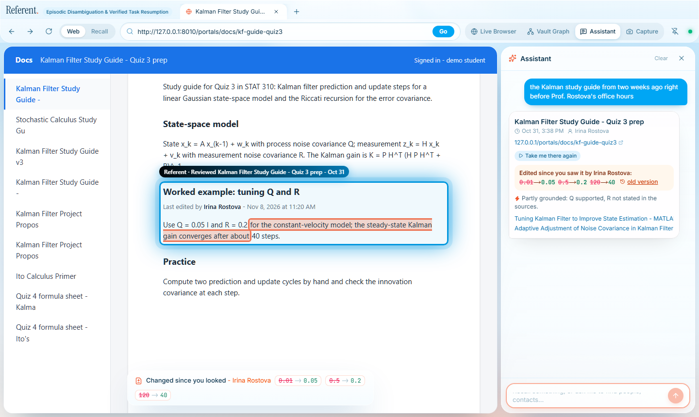
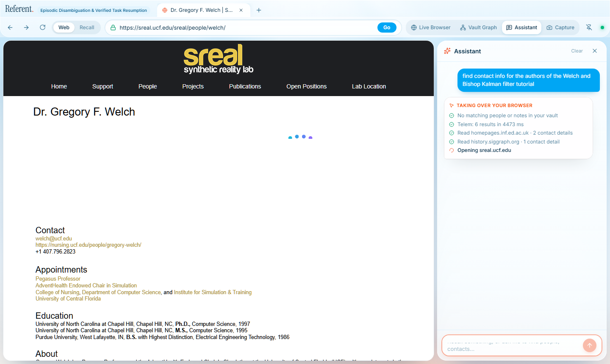
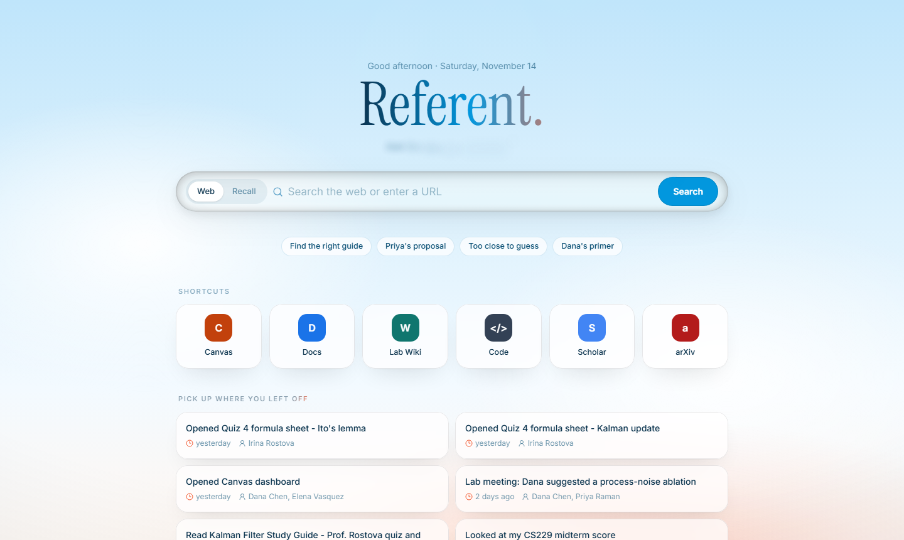
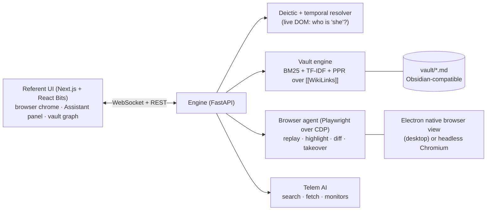

# Referent

**A browser that remembers what you saw, and an agent that takes over to finish the job.**

Ask the way you actually remember things: *"the Kalman study guide from two weeks ago, right before Prof. Rostova's office hours."*
Referent works out which of ten lookalike documents you meant, drives the browser back to the exact section,
tells you what changed since you last saw it, and checks the change against the web with **Telem AI**.
Or hand it a task, such as *"find contact info for the authors of the Welch and Bishop Kalman filter tutorial,"*
and watch it take over your tab, read the pages, and return the answers with links.



## What it does

| | |
|---|---|
| **Recall by memory, not keywords** | Your browsing becomes an Obsidian-style vault: episodes, people, courses and events linked with `[[WikiLinks]]`. A recall resolves *who* ("she" or "Irina"), *when* ("two weeks ago", "right before office hours") and *what* against that graph, then replays the recorded actions to restore the exact view. |
| **Refuses to guess** | If the top two memories are within 15% of each other, it shows both and lets you pick instead of guessing. |
| **Silent-edit detection** | Each episode stores the text as you saw it. After a restore, a word-level diff shows what changed and who changed it (*Q 0.01 → 0.05, edited by Irina Rostova*), and the old version is one click away. |
| **Agent takeover** | In the Assistant panel, ask for a task. It reads your vault for context, searches with Telem, opens and reads the top pages **in your own tab** while you watch, and reports contacts and links. Every step streams live. |
| **Clean by default** | The main view is just the browser. The toolbar hides until you touch the top edge (or press Ctrl+L). Everything else is in one side panel. |



## How Telem AI powers it

Telem is the retrieval layer for everything that leaves the machine. It is used in three ways, and none of it would work with a plain search box:

1. **Episodic query compiler → `POST /v1/search`.**
   *"What was that study guide Irina mentioned?"* has no searchable keywords. The vault graph resolves the private anchors locally (person, course, time; these **never leave the device**) and compiles only allow-listed public topic tags plus the numeric drift into a precise query, for example
   `steady-state Kalman gain process noise covariance tuning … Q=0.01 vs Q=0.05 R=0.5 vs R=0.2`.
   A single **batched** Telem call also carries a claim-verification query (*"effect of increasing Q and decreasing R on Kalman gain and convergence"*). Results from Telem's routed providers (Brave, Exa, Perplexity) are merged with **reciprocal-rank fusion**, so sources the providers agree on rise.
2. **Grounded drift verification → `POST /v1/fetch`.**
   Clean text from the top sources is scanned for statements about how each edited quantity behaves. The result is a verdict such as *"Live edit grounded: raising Q and lowering R raises the Kalman gain and speeds convergence"*, with quoted citations, Telem rank scores and latency. If Telem is unreachable, clearly labelled cached references are used; nothing cached is ever shown as live.
3. **Continuous claim watch → `POST /v1/monitors`.**
   One click arms a 14-day Telem monitor on the assumption (`POST /api/telem/monitors`), and its status is read back from Telem.

Agent tasks reuse the same path: Telem search finds the pages, then the agent reads them in the live browser.
The code is in [`backend/telem_pipeline.py`](backend/telem_pipeline.py); the date-filtered "new since your snapshot" search is in [`backend/search_federation.py`](backend/search_federation.py).

## How recall scores candidates

```
S       = w_sem * S_sem + w_time * S_time + w_graph * S_graph
S_sem   = 0.6 * BM25 + 0.4 * cosine(hashed TF-IDF uni+bigrams)
S_time  = exp(-(t - mu)^2 / 2 sigma^2)      mu/sigma from "2 weeks ago", or a calendar anchor
                                             ("right before <event>" -> event - 25 min, sigma 45 min)
S_graph = Personalized PageRank (alpha 0.85) over [[WikiLinks]], seeded by DOM-resolved people,
          named entities, page context and the anchor event
abstain when (S1 - S2) / S1 < 0.15
```

A keyword/vector baseline runs alongside. On the study-guide demo it picks the wrong lookalike (the guide with the most matching words); the relational and temporal resolver picks the one you opened 22 minutes before office hours.

## Try it

Open the Assistant (toolbar, or **Ctrl+J**) and type, or click a suggestion:

| Ask | What happens |
|---|---|
| *the Kalman study guide from two weeks ago right before Prof. Rostova's office hours* | Picks the Quiz 3 guide out of 10 lookalikes, restores the "tuning Q and R" section, flags Irina's silent edit, and grounds it with Telem. |
| *the proposal method section we revised with Priya Raman eight days ago* | A different person and context: restores the revised method section. |
| *the formula sheet I had open last night for Rostova's quiz* | Two sheets opened 3 minutes apart: Referent asks which one. |
| *find contact info for the authors of the Welch and Bishop Kalman filter tutorial* | Agent takeover: Telem search, then it reads three pages in your tab and returns the emails, phone number and profiles it found. |
| *look up Dana Chen and what we worked on* | A person you know: answered from your vault history, opening your latest page with her, without searching the web for a namesake. |

New tabs open a start page with the same recall box, shortcuts, and your recent episodes:



## Run it

Requirements: Windows 10/11, Python 3.11+, Node 20+.

```powershell
# one-time setup
cd backend
python -m venv .venv
.\.venv\Scripts\python.exe -m pip install -r requirements.txt
.\.venv\Scripts\python.exe -m playwright install chromium
cd ..\frontend; npm install; npm run build      # UI is served by the engine from frontend/out
cd ..\desktop;  npm install
copy ..\.env.example ..\.env                     # then add TELEM_API_KEY (and optionally TAVILY_API_KEY)
```

```powershell
# desktop app: native browser view, agent takeover, auto-hiding toolbar
cd desktop; npm start

# or developer mode in any browser (pages are streamed from a headless Chromium)
cd backend; .\.venv\Scripts\python.exe main.py   # engine on http://127.0.0.1:8000
cd frontend; npm run dev                          # UI on http://localhost:3000
```

`npm run dist` in `desktop/` builds a Windows installer (`desktop/dist/Referent Setup 1.0.0.exe`). The installed app runs this folder's Python environment and vault (path in `desktop/package.json` → `recallRoot`).

Without `TELEM_API_KEY` everything local still works (recall, replay, diffs); the web steps report "not configured".

| Shortcut | |
|---|---|
| Ctrl+L / Ctrl+K | Show the toolbar and focus the address bar (K = recall mode) |
| Ctrl+J | Assistant panel |
| Ctrl+B | Vault graph |
| Ctrl+T / Ctrl+W | New tab / close tab |

## Architecture



```
backend/   main.py (API, WebSocket hub, recall + assistant pipelines) · telem_pipeline.py · search_federation.py
           vault_engine.py · deictic_resolver.py · browser_agent.py · home_page.py · mock_portals.py · seed_vault.py
frontend/  Next.js 16 + Tailwind 4: BrowserChrome, BrowserViewport, AssistantPanel, ObsidianPane, app/newtab
desktop/   Electron shell: native browsing view, cursor-edge reveal, preload bridge, installer
vault/     the demo vault (.md + YAML frontmatter + [[WikiLinks]]), which you can open in Obsidian too
```

The demo runs against local mock portals (Canvas, Docs, Codehub, Lab Wiki) served by the engine, so the scenarios are reproducible. Ordinary browsing works on any site.

**Privacy.** Recall, the vault, the graph and the diffs all stay on your machine. For grounding, only allow-listed public topic tags and numbers are sent to Telem. Agent tasks send the task as you typed it, because that is the point of the task.

**Credits.** UI effects from [React Bits](https://reactbits.dev) (LightRays, GradientText, BlurText, GlassSurface, SpotlightCard, StarBorder, ShinyText, CountUp), icons from [Lucide](https://lucide.dev), graph by [react-force-graph](https://github.com/vasturiano/react-force-graph), web retrieval by [Telem AI](https://telem.ai).

**Limits.** Agent tasks follow built-in patterns (recall, look up a person, search, read pages, extract contacts); there is no LLM planner yet, so it does not fill forms or click through multi-step flows. The scoring weights are hand-tuned on the demo vault.
